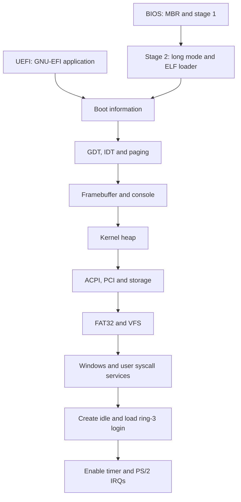

# System overview

[Documentation index](../index.md)

The BIOS and UEFI loaders do the firmware-specific work and pass a common set
of information to `kernel_main`: the framebuffer, font, memory map, ACPI root,
and boot mode. The kernel then installs its own CPU structures and memory
management before discovering devices and filesystems.

## Source layout

| Directory | Responsibility |
| --- | --- |
| [boot/BIOS](../../boot/BIOS/) | MBR, stage 1, and the C/assembly second stage |
| [boot/UEFI/gnu-efi/bootloader](../../boot/UEFI/gnu-efi/bootloader/) | Project UEFI application inside the vendored GNU-EFI tree |
| [kernel/src/arch/x86_64](../../kernel/src/arch/x86_64/) | CPU tables, interrupts, paging, port I/O, timers, and syscall entry |
| [kernel/src/memory](../../kernel/src/memory/) | Firmware map interpretation and heap allocation |
| [kernel/src/acpi](../../kernel/src/acpi/) | ACPI tables, PCI enumeration, and power-management support |
| [kernel/src/drivers](../../kernel/src/drivers/) | Storage, input, graphics, and experimental USB |
| [kernel/src/fs](../../kernel/src/fs/) | Filesystem interfaces, VFS dispatch, and FAT32 |
| [kernel/src/proc](../../kernel/src/proc/) | ELF loading and task management |
| [common](../../common/) | Shared freestanding memory/string routines, containers and syscall wrappers |
| [include/hackos](../../include/hackos/) | Shared types and experimental syscall ABI catalogue |
| [kernel/src/lib](../../kernel/src/lib/) | Kernel allocation/output adapters and compatibility includes |
| [libs](../../libs/) | Userspace runtime, shell, and example programs |
| [libs/editor](../../libs/editor/) | [Graphical text editor](editor.md) |
| [libs/files](../../libs/files/) | [Graphical file manager](files.md) |
| [libs/gui](../../libs/gui/) | [Userspace GUI library](gui.md): drawing, layout, widgets and dialogs |
| [util](../../util/) | Fonts, retained program fixture, copied program outputs, and host utilities |

## Kernel startup

The entry point is [kernel_main](../../kernel/src/kernel.cpp). It initializes COM1
and logs the boot path before graphics, then calls
`InitialiseDisplay` and `InitialiseKernel`, copies the backbuffer to the display,
and becomes the idle task. Idle reclaims exited task stacks and halts between IRQs.

[kernelInit.cpp](../../kernel/src/init/kernelInit.cpp) divides initialization
into two phases:

1. `InitialiseDisplay` selects BIOS or EFI memory-map interpretation, disables
   interrupts, installs the GDT and IDT, sets up paging, and initializes the
   framebuffer console.
2. `InitialiseKernel` creates the heap, initializes device/filesystem registries,
   discovers ACPI/PCI devices, adds an ATA device, locates FAT32 on `devices[0]`,
   creates window state, registers syscalls, creates idle, loads the standalone
   ring-3 login agent and enables IRQs.

`kernel_main` remains idle, refreshes the dirty console and reaps exited tasks.
The standalone `~/USR/BIN/SHELL` owns command parsing and PS/2 line editing in
ring 3. Its checked syscall interface supplies terminal, file, process and power
services, plus inherited working directories and UID/GID/group credentials.
[System utilities](utilities.md) provide normal-user text filters, paging and terminal appearance,
literal output, the clock and root-only
hardware reports. [Standard streams](streams.md) add descriptors, pipes, redirection, poll and
scheduler deadlines.
The shell starts after authentication; account administration requires UID 0.
Power also requires UID 0, except for the boot login agent while it owns the
logged-out terminal and displays login/restart/shutdown actions. Kill permits the
same UID or root. Accounts persist in two FAT32
slots, and first-boot setup creates the administrator. See [accounts](accounts.md).
Directory/history/session and job controls remain
built-ins; bare names resolve to standalone programs in `/usr/bin`. Explicit
paths and the `user` compatibility prefix also launch isolated programs; no interactive command
executes a ring-0 ELF. The binary-only `USERTEST.ELF` input remains packaged but
is no longer called at boot.

## Important boundaries

- Boot structures cross independently compiled C and C++ components. Their
  layout is an ABI; see [boot and handoff](boot.md).
- Interrupt and task-switch assembly share a saved-register layout with C++.
  Keep those definitions synchronized; see [interrupts](interrupts.md).
- Filesystems operate through the `Device` interface. This is a useful future
  test boundary; see [filesystems](filesystems.md).
- Kernel support functions resemble libc but do not all have standard libc
  semantics. Read the implementation before substituting a hosted function.
- Userspace exchanges copied ABI records and process-owned handles with the kernel.
  Treat the [program interface](userspace.md) as experimental.

Continue with [memory](memory.md), [devices](devices.md), or [graphics](graphics.md).

The [desktop and terminal guide](desktop.md) covers the authenticated launcher,
taskbar, independent terminal endpoints and recovery login.
