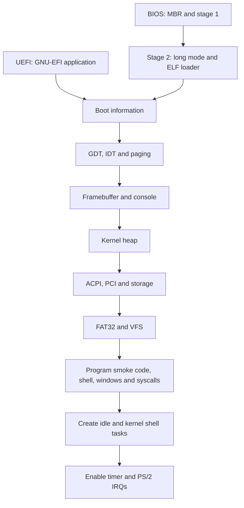

# System overview

[Documentation index](../index.md)

The BIOS and UEFI loaders do the firmware-specific work and pass a common set
of information to `kernel_main`: the framebuffer, font, memory map, ACPI root,
and boot mode. The kernel then installs its own CPU structures and memory
management before discovering devices and filesystems.

## Source layout

| Directory | Responsibility |
| --- | --- |
| [boot/BIOS](../../boot/BIOS/) | MBR, stage 1, and the C/assembly second stage |
| [boot/UEFI/gnu-efi/bootloader](../../boot/UEFI/gnu-efi/bootloader/) | Project UEFI application inside the vendored GNU-EFI tree |
| [kernel/src/arch/x86_64](../../kernel/src/arch/x86_64/) | CPU tables, interrupts, paging, port I/O, timers, and syscall entry |
| [kernel/src/memory](../../kernel/src/memory/) | Firmware map interpretation and heap allocation |
| [kernel/src/acpi](../../kernel/src/acpi/) | ACPI tables, PCI enumeration, and power-management support |
| [kernel/src/drivers](../../kernel/src/drivers/) | Storage, input, graphics, and experimental USB |
| [kernel/src/fs](../../kernel/src/fs/) | Filesystem interfaces, VFS dispatch, and FAT32 |
| [kernel/src/proc](../../kernel/src/proc/) | ELF loading and task management |
| [kernel/src/lib](../../kernel/src/lib/) | Freestanding support routines and containers |
| [libs](../../libs/) | Userspace runtime, shell, and example program |
| [util](../../util/) | Fonts, retained program fixture, copied program outputs, and host utilities |

## Kernel startup

The entry point is [kernel_main](../../kernel/src/kernel.cpp). It calls
`InitialiseDisplay` and `InitialiseKernel`, copies the backbuffer to the display,
and becomes the idle task. Idle reclaims exited task stacks and halts between IRQs.

[kernelInit.cpp](../../kernel/src/init/kernelInit.cpp) divides initialization
into two phases:

1. `InitialiseDisplay` selects BIOS or EFI memory-map interpretation, disables
   interrupts, installs the GDT and IDT, sets up paging, and initializes the
   framebuffer console.
2. `InitialiseKernel` creates the heap, initializes device/filesystem registries,
   discovers ACPI/PCI devices, adds an ATA device, locates FAT32 on `devices[0]`,
   runs the program-loading smoke path, creates shell/window state, registers
   syscalls, creates idle/shell tasks, and enables IRQs.

`InitialiseFilesystem` currently attempts to load and call `USERTEST.ELF`.
It is executable smoke code in the startup path, not a filesystem mount routine
or an automated test runner.

The separate `kernel_task` function runs the interactive kernel shell. It drains
the keyboard queue, executes commands outside interrupt context, and refreshes
the console when output changes. The experimental userspace window shell is not
launched automatically. All scheduled tasks remain in ring 0.

## Important boundaries

- Boot structures cross independently compiled C and C++ components. Their
  layout is an ABI; see [boot and handoff](boot.md).
- Interrupt and task-switch assembly share a saved-register layout with C++.
  Keep those definitions synchronized; see [interrupts](interrupts.md).
- Filesystems operate through the `Device` interface. This is a useful future
  test boundary; see [filesystems](filesystems.md).
- Kernel support functions resemble libc but do not all have standard libc
  semantics. Read the implementation before substituting a hosted function.
- Userspace currently shares kernel assumptions and objects. Treat the
  [program interface](userspace.md) as experimental.

Continue with [memory](memory.md), [devices](devices.md), or [graphics](graphics.md).
